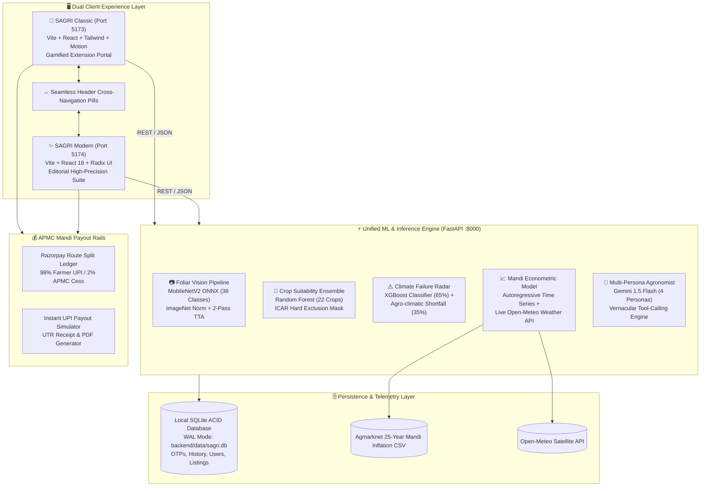

# 🌾 SAGRI — Smart Agriculture Real-time Intelligence
### *Autonomous Multimodal AI Ecosystem & Instant Mandi Payout Engine for Indian Agriculture*

[](https://github.com/Shikhar-Kesharwani/Sagriai)
[](https://vitejs.dev/)
[](https://www.typescriptlang.org/)
[](https://fastapi.tiangolo.com/)
[](https://onnxruntime.ai/)
[](https://xgboost.readthedocs.io/)
[](https://sqlite.org/)
[](https://razorpay.com/)

---

## 🚀 Live Deployments & Repository Overview

* **🌾 Classic Agronomist Portal:** [`http://localhost:5173`](http://localhost:5173) *(Vibrant green, 3D Canvas visualizer, gamified extension tools)*
* **✨ Modern Intelligence Suite:** [`http://localhost:5174`](http://localhost:5174) *(High-precision editorial interface, Linear/Palantir aesthetic, research grade)*
* **⚡ Unified ML Backend API:** [`http://localhost:8000`](http://localhost:8000) *(FastAPI, ONNX Runtime, Scikit-Learn, XGBoost, SQLite WAL)*
* **🌐 Production Cloud Deploy:** [https://sagriai.vercel.app](https://sagriai.vercel.app) *(Mirror: [sagri-final.vercel.app](https://sagri-final.vercel.app))*
* **📂 GitHub Repository:** [https://github.com/Shikhar-Kesharwani/Sagriai](https://github.com/Shikhar-Kesharwani/Sagriai)

---

## 🎯 The Core Problem SAGRI Solves

Over 140 million smallholder farmers in India suffer recurring **20% to 30% yield loss** and devastating margin shrinkage due to three systemic bottlenecks:

1. **Delayed Foliar Pathology:** Lack of accessible agricultural scientists leaves fungal and bacterial infections unchecked. Farmers apply incorrect, toxic chemicals based on guesswork.
2. **Mandi Price Opacity & Predatory Intermediaries:** Farmers accept distress pricing at APMC market gates because transportation costs, statutory fees, and historical arrival trends are hidden.
3. **Linguistic & Digital Barriers:** Over 65% of smallholders cannot navigate complex text-heavy government portals due to vernacular dialects and low digital literacy.

**SAGRI bridges this divide** through a multimodal AI architecture combining computer vision, agronomic constraint-gated crop recommendation, non-linear climate risk modeling, econometric mandi forecasting, and instant APMC UPI payout simulation.

---

## 🏗️ System Architecture & Dual-Platform Topology



---

## 🧠 The 5 Core Machine Learning & AI Pipelines

### 1. 📷 Deep Learning Foliar Pathology (`/api/predict_disease`)
* **Architecture:** Quantized **MobileNetV2 Convolutional Neural Network** deployed in ONNX Runtime format (`16.2 MB`, $3.4\text{M}$ parameters).
* **Scope:** 38 plant pathology classes spanning 14 major agricultural crops (PlantVillage standard).
* **Pipeline:** Center square crop $\to$ bilateral interpolation to $224 \times 224$ px $\to$ ImageNet normalization ($\mu=[0.485, 0.456, 0.406], \sigma=[0.229, 0.224, 0.225]$) $\to$ **2-pass Test-Time Augmentation (TTA)** with horizontal flip averaging.
* **Calibrated Output:** Returns **honest, unadulterated softmax probabilities** (zero fake inflation), top-3 differential diagnosis, pathogen taxonomy (fungal, bacterial, viral), and CIBRC-approved chemical and bio-control remedies.

### 2. 🌱 Agronomic Crop Recommendation (`/api/predict_crop`)
* **Architecture:** 100-tree **Random Forest Classifier** trained on multi-modal soil and climatic features.
* **Feature Vector:** Soil Nitrogen (N), Phosphorus (P), Potassium (K), Soil pH, Temperature, Relative Humidity, and Precipitation.
* **Agronomic Constraint Layer:** Raw ML models can suggest water-intensive paddy in arid zones if nutrients match. SAGRI enforces **hard geographical exclusion masks** based on ICAR agro-climatic zones (`HARD_EXCLUSIONS`) and physiological boundaries (`BIO_LIMITS`) to prevent invalid agricultural advice.

### 3. ⚠️ Climate & Yield Failure Risk Radar (`/api/predict_risk`)
* **Architecture:** Hybrid fusion of an **XGBoost Classifier** ($65\%$) and a physical **Agro-climatic Shortfall Engine** ($35\%$).
* **Stress Telemetry:** Analyzes non-linear microclimatic stress: diurnal temperature swings, heat stress above physiological thresholds, rainfall deficits against crop water requirements, soil $N:P$ imbalances, and wind desiccation.
* **Deterministic Scoring:** Delivers a realistic, calibrated $0\%\text{--}100\%$ risk probability with **zero random dice rolls**.

### 4. 📈 Mandi Price Trajectory Forecasting (`/api/forecast_price`)
* **Architecture:** Autoregressive Econometric Time Series Model.
* **Dataset:** 25-year Agmarknet historical dataset normalized against the Consumer Food Price Index (`clean_prices_final_inflation.csv`).
* **Live Weather Telemetry:** Dispatches real-time requests to the **Open-Meteo API** to factor regional temperature and rainfall anomalies into forward-looking supply elasticity curves.
* **Output:** 6-month projected modal price per quintal + Instant Mandi APMC net settlement calculator.

### 5. 🤖 Multi-Persona AI Agronomist (`/api/expert-chat`)
* **Engine:** Google Gemini 1.5 Flash with localized vernacular prompting in English, Hindi, and Punjabi.
* **Personas:** 4 specialized domain agents:
  1. *General Field Agronomist*
  2. *Soil Health & Nutrient Specialist*
  3. *APMC Mandi Market & Commodities Analyst*
  4. *Integrated Pest Management (IPM) Pathologist*

---

## 🗄️ Local ACID SQLite Persistence Layer

To guarantee complete operational reliability in rural and offline environments, SAGRI eliminates dependency on volatile cloud databases:

* **Engine:** Embedded SQLite with **Write-Ahead Logging (`PRAGMA journal_mode=WAL;`)** at `backend/data/sagri.db`.
* **Zero Configuration:** Automatically initializes on backend startup.
* **Permanent Data Persistence:**
  * `otp_sessions`: High-security OTP credentials stored with 5-minute TTL.
  * `users`: Farmer profiles, land sizes, locations, and gamified Krishi points.
  * `prediction_history`: Full audit trail of every disease scan, crop advice, and risk assessment across both frontends.
  * `marketplace_listings`: Real-time farmer crop listings, equipment rentals, and seed inquiries.

---

## 🛠️ The Complete 12 Platform Modules

| Module | Route | Key Capabilities |
| :--- | :--- | :--- |
| **Disease Detection** | `/disease-detection` | ONNX MobileNetV2 leaf scan, top-3 differential diagnosis, CIBRC chemical/organic sprays |
| **Crop Recommendation** | `/crop-recommendation` | Random Forest NPK + weather analysis, ICAR exclusions, yield & revenue projection |
| **Price Forecasting** | `/price-forecasting` | 6-month modal price curve, inflation adjustments, live Open-Meteo weather correlation |
| **Risk Radar** | `/risk-radar` | XGBoost microclimate failure scoring, heat/drought stress analysis, mitigation advice |
| **Mandi Payout Engine** | `/market-rates` | APMC 98% farmer / 2% cess split ledger, instant UPI simulation, PDF transaction receipt |
| **Soil Health Matrix** | `/soil-health` | Soil texture classification, NPK balance ratios, targeted fertilizer prescription |
| **KCC Loans & Finance** | `/loans` | Kisan Credit Card eligibility calculator, interest subvention checks, document helper |
| **Government Schemes** | `/schemes` | Central & state agriculture schemes (PM-KISAN, PMFBY, PKVY) with subsidy criteria |
| **Buy Certified Seeds** | `/buy-seeds` | High-yield hybrid varieties, germination ratings, direct-to-farm ordering |
| **Rent Farm Machinery** | `/rent-machinery` | Tractor, harvester, and drone rental booking with hourly and per-acre rates |
| **Sell Produce (Mandi)** | `/sell-produce` | Direct listing for local buyers and traders, bypassing exploitative middlemen |
| **Expert Agronomist Chat** | `/expert-connect` | Gemini 1.5 Flash multi-persona voice and text advisory in Hindi, Punjabi, and English |

---

## ⚡ Quick Start & Development Guide

### 🚀 1-Click Windows Launcher (Fastest)

Double-click the pre-configured Windows batch script in the repository root:
```
start_all_servers.bat
```
This automatically boots:
1. **ML Backend API** on `http://localhost:8000`
2. **Classic SAGRI Platform** on `http://localhost:5173`
3. **Modern SAGRI Intelligence** on `http://localhost:5174`
4. Launches your default browser to both portals simultaneously.

---

### 💻 Running in VS Code

We have pre-configured [`.vscode/tasks.json`](.vscode/tasks.json) and [`.vscode/launch.json`](.vscode/launch.json) for 1-click execution:

1. Open the project folder in VS Code (`code .`).
2. Press:
   $$\mathbf{Ctrl + Shift + B}$$
3. Select **`Run Modern Version (Backend + Port 5174)`**.
4. *(Alternatively, press <kbd>F5</kbd> to launch with interactive debugging and browser opening).*

---

### ⌨️ Terminal Commands (Manual Setup)

#### 1. Clone & Install Dependencies
```bash
# Clone the repository
git clone https://github.com/Shikhar-Kesharwani/Sagriai.git
cd Sagriai

# Install root dependencies (Classic Platform)
npm install

# Install Modern Version dependencies
cd new_frontend && npm install && cd ..

# Setup Python Virtual Environment for ML Backend
cd backend
python -m venv venv
.\venv\Scripts\activate
pip install -r requirements.txt
cd ..
```

#### 2. Run Commands via NPM (Root Directory)
```bash
# Run Classic Platform (Port 5173)
npm run dev:classic

# Run Modern Intelligence Platform (Port 5174)
npm run dev:modern

# Run ML Backend Server (Port 8000)
npm run dev:backend

# Build both production bundles
npm run build:all
```

---

## 📂 Repository File Structure

```
Sagriaibest/
├── backend/                             # FAST-INFERENCE MACHINE LEARNING ENGINE
│   ├── main.py                          # FastAPI routing, ONNX runtime, and model inference
│   ├── database.py                      # SQLite ACID storage (WAL mode)
│   ├── geo_exclusions.py                # ICAR regional crop exclusion matrix
│   ├── pathology_kb.py                  # CIBRC chemical & organic pathology knowledge base
│   ├── data/
│   │   ├── sagri.db                     # Permanent on-disk SQLite database
│   │   └── clean_prices_final_inflation.csv # 25-year Agmarknet historical dataset
│   └── models/
│       ├── disease_model.onnx           # MobileNetV2 plant pathology vision model (16.2 MB)
│       ├── crop_random_forest.pkl       # 22-crop Scikit-Learn Random Forest ensemble
│       ├── crop_risk_model.pkl          # Trained XGBoost Classifier for failure risk
│       └── class_names.json             # 38 PlantVillage taxonomy classes
│
├── src/                                 # VERSION 1: CLASSIC SAGRI PLATFORM (Port 5173)
│   ├── app/
│   │   ├── components/                  # Header, VoiceAssistant, AuthProvider
│   │   ├── pages/                       # 12 agritech modules + 3D Canvas visualizer
│   │   └── lib/                         # Client services and API clients
│   └── package.json                     # Root npm package configuration
│
├── new_frontend/                        # VERSION 2: MODERN INTELLIGENCE SUITE (Port 5174)
│   ├── src/
│   │   ├── app/                         # AppShell, CommandPalette, LanguageContext
│   │   ├── pages/                       # High-precision editorial UI tools
│   │   └── data/                        # Static regional datasets, agronomic profiles
│   └── package.json                     # Standalone modern frontend configuration
│
├── .vscode/                             # VS CODE 1-CLICK WORKSPACE CONFIGURATION
│   ├── tasks.json                       # Automated multi-process build tasks
│   └── launch.json                      # Single-key (F5) debug & browser launcher
│
├── start_all_servers.bat                # Windows single-click orchestrator launcher
├── SAGRI_DUAL_VERSION_GUIDE.md          # Dual-platform operations & architecture manual
└── README.md                            # Primary project documentation
```

---

## 👥 Contributors & Acknowledgements

Developed by the **SAGRI Engineering Team** for the **Razorpay AI Builder** initiative. 

Dedicated to empowering India's 140+ million farmers with autonomous multimodal artificial intelligence and transparent financial rails.
